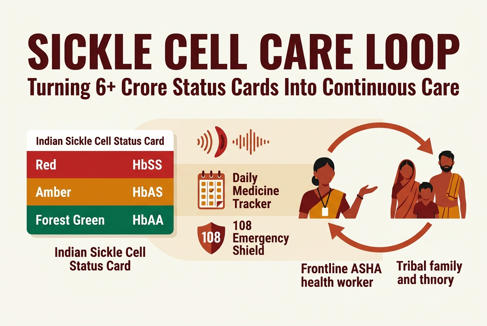
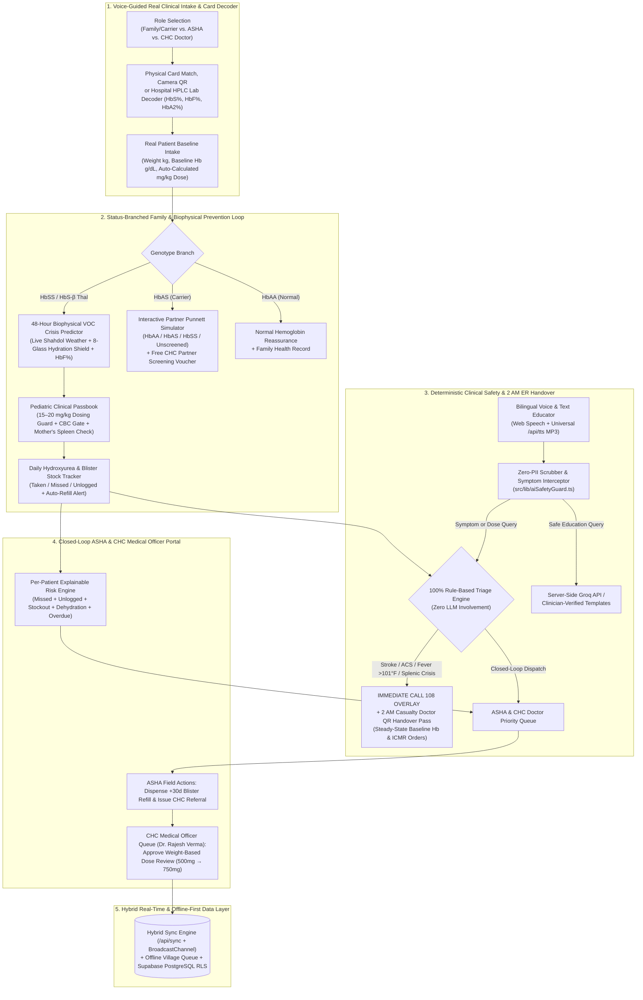
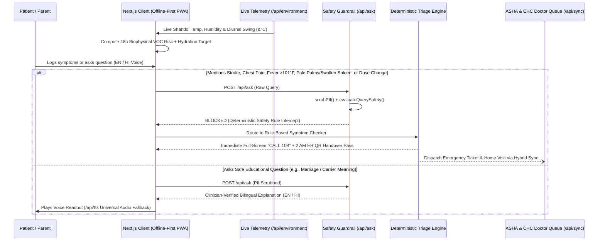

# Sickle Cell Care Loop (After the Card)

> **India screened 6+ crore people for sickle cell, but a status card is not care. We solve what happens the day after.**  
> *Built for UnivaBio 2026 — Theme: AI for Human Health (Detect Earlier • Understand Better • Live More Easily)*

🔗 **Live Production App:** **[https://sickle-cell-care-loop.vercel.app/](https://sickle-cell-care-loop.vercel.app/)**



---

## 1. Problem Statement & Peer-Reviewed Evidence

India’s **National Sickle Cell Anaemia Elimination Mission (NSCAEM)** (launched in Shahdol, Madhya Pradesh) has screened **over 6.04 crore (60+ million) people**, diagnosing **2.16+ lakh patients (`HbSS`)** and identifying **16.7+ lakh carriers (`HbAS`)**. Yet issuing a physical or digital status card does not guarantee continuous care:

| Post-Screening Gap | Documented Clinical & Field Evidence |
| :--- | :--- |
| **1. High Treatment Dropout & Blister Stockouts** | In a tribal Gujarat cohort of 404 patients, **Hydroxyurea** raised coverage from 3.5% to 88% and reduced pain crises from **277 to 53.4 per 100 person-years**, yet **~25% were lost to follow-up** (*Dave et al., 2019*). In Bhopal, pediatric non-adherence was driven by improper follow-up (**64.5%**), drug unavailability (**67.7%**), and unawareness (**54.8%**) (*JCDR, 2022*). |
| **2. Pediatric Growth Drift (`mg/kg/day`) & Acute Splenic Crisis** | Children prescribed Hydroxyurea (`15–20 mg/kg/day`) outgrow fixed doses without CHC dose review, while parents lack guided training to detect **Acute Splenic Sequestration** (sudden pale palms + left abdominal fullness) or hand over baseline Hemoglobin (`g/dL`) at 2 AM in casualty. |
| **3. Status Card & Carrier Misunderstanding** | In Koraput, Odisha, most respondents believed carriers actively transmit the disease and did not know that **carrier × carrier (`HbAS × HbAS`) marriage** carries a **25% (1 in 4) per-pregnancy risk** (*PMC7475140*). In the Indian SCD Registry, **85.2% of 324 tribal patients** did not know their status before enrolling (*ISCDR, 2024*). |
| **4. Preventable Environmental & Dehydration VOC Crises** | Microvascular $\text{HbS}$ polymerization is biophysically accelerated by **intracellular dehydration (high MCHC)** and **extreme heat / diurnal temperature swings** in central Indian tribal belts—yet families receive zero 48-hour preventative early warnings. |

---

## 2. End-to-End Closed-Loop System Architecture



---

## 3. Clinical Safety Gate & Triage Sequence

AI is strictly restricted to plain-language education. **Emergency triage, splenic crisis detection, and weight-based medication boundaries are 100% deterministic**:



---

## 4. Novel Clinical & Engineering Modules

1. **48-Hour Biophysical VOC Crisis Predictor (`src/lib/vocPredictor.ts` & `src/components/VocPredictorCard.tsx`):**
   - Pulls live meteorological telemetry for **Shahdol, MP (`23.30°N, 81.36°E`)** via `/api/environment` and models the four biophysical drivers of microvascular $\text{HbS}$ polymerization: thermal/diurnal stress, intracellular dehydration (interactive 8-glass counter), protective $\text{HbF}\%$, and prodromal symptoms.
2. **Pediatric Weight-Based Dosing & Mother’s Spleen Passbook (`src/components/ClinicalPassbook.tsx`):**
   - Verifies whether a child’s prescribed Hydroxyurea dose falls within the ICMR/NHM **`15–20 mg/kg/day`** therapeutic window as they grow, displays HPLC fractions ($\text{HbF}\%$, $\text{HbS}\%$, **Baseline $\text{Hb g/dL}$**), and provides a voice-guided **Home Spleen Palpation Check** to catch Acute Splenic Sequestration early.
3. **2 AM Casualty / ER Physician Handover Pass (`src/components/EmergencyHandoverModal.tsx`):**
   - Generates an offline-rendered deterministic SVG QR code and emergency summary displaying steady-state **Baseline Hemoglobin** (alerting casualty doctors if $\text{Hb}$ drops $>2\text{ g/dL}$ below baseline), blood group, weight, and ICMR ER standing orders.
4. **3-Mode Scanner, Hospital HPLC Lab Decoder & Live Intake (`src/components/MockQrScanner.tsx` & `src/components/OnboardingFlow.tsx`):**
   - Includes a live WebRTC camera viewfinder, an **HPLC Hemoglobin Electrophoresis interpreter** that detects `HbSS`, `HbAS`, `HbAA`, and **Compound $\text{HbS}-\beta$ Thalassemia** ($\text{HbA2} > 3.8\%$), and custom patient enrollment.
5. **Explainable Per-Patient Risk & Hybrid Offline-First Sync (`src/lib/riskEngine.ts` & `src/context/AppContext.tsx`):**
   - Explicitly separates **`TAKEN`**, **`MISSED`**, **`UNLOGGED`**, **Blister Stock Exhaustion**, and **Dehydration**:
   $$\text{Risk Score} = \min\Big(100,\; 15 \cdot D_{\text{missed}} + 5 \cdot D_{\text{unlogged}} + \min(3 \cdot T_{\text{overdue}},\, 30) + 20 \cdot S_{\text{warning}} + P_{\text{stock}} + P_{\text{dehydration}}\Big)$$

---

## 5. Project Structure

```text
├── docs/
│   └── SUBMISSION_PACKAGE.md          # 1-Page Executive Summary, Demo Script & Limitations
├── public/
│   └── manifest.json                  # PWA manifest for mobile installation
├── scripts/
│   └── verify-rules.mjs               # 12/12 automated test suite (triage, VOC, dosing, stock, PII)
├── src/
│   ├── app/
│   │   ├── api/
│   │   │   ├── ask/route.ts           # Server-side guarded educator endpoint
│   │   │   ├── environment/route.ts   # Live Shahdol Open-Meteo weather telemetry endpoint
│   │   │   ├── models/route.ts        # Live Groq model verifier
│   │   │   ├── sync/route.ts          # Hybrid cloud & multi-role state synchronization API
│   │   │   ├── transcribe/route.ts    # Server-side Whisper-large-v3-turbo voice endpoint
│   │   │   └── tts/route.ts           # Universal MP3 TTS fallback for Linux/mobile browsers
│   │   ├── globals.css                # Clinical typography & warm ivory/crimson theme
│   │   ├── layout.tsx                 # Root layout & PWA metadata
│   │   └── page.tsx                   # Onboarding & status-branched clinical router
│   ├── components/
│   │   ├── AdherenceTracker.tsx       # HbSS daily Hydroxyurea + blister stock & CHC referrals
│   │   ├── AshaDashboard.tsx          # ASHA field outreach + CHC Medical Officer approval queue
│   │   ├── AskEducator.tsx            # Voice/Text Q&A with live safety interceptor
│   │   ├── CarrierCounseling.tsx      # Interactive Partner Genotype Punnett Simulator & Voucher
│   │   ├── ClinicalPassbook.tsx       # Pediatric mg/kg dosing guard, HPLC ledger & spleen guide
│   │   ├── EmergencyHandoverModal.tsx # 2 AM Casualty Doctor SVG QR Handover Pass
│   │   ├── EmergencyModal.tsx         # Immediate Call 108 overlay
│   │   ├── MissionBanner.tsx          # NSCAEM Shahdol/Bhopal mission context
│   │   ├── MockQrScanner.tsx          # 3-Mode Camera QR, HPLC Lab Decoder & Patient Enrollment
│   │   ├── Navbar.tsx                 # Live Role Switcher, Offline Village Mode toggle & Language
│   │   ├── OnboardingFlow.tsx         # Voice-guided real clinical intake & card configuration
│   │   ├── SymptomChecker.tsx         # Deterministic stroke/ACS/fever/splenic rule checker
│   │   ├── UnderstandCard.tsx         # Voice-narrated card explanation
│   │   └── VocPredictorCard.tsx       # 48h Biophysical VOC Crisis Predictor & Hydration Shield
│   ├── context/
│   │   └── AppContext.tsx             # Hybrid real-time store, BroadcastChannel & offline queue
│   └── lib/
│       ├── aiSafetyGuard.ts           # PII scrubber & symptom/dosage safety interceptor
│       ├── constants.ts               # Bilingual clinical templates & Shahdol cohort records
│       ├── riskEngine.ts              # Per-patient explainable heuristic risk calculator
│       ├── speechService.ts           # Web Speech API + /api/tts MP3 audio fallback
│       ├── triageEngine.ts            # Deterministic emergency & splenic triage rules
│       ├── types.ts                   # Strict TypeScript domain interfaces
│       └── vocPredictor.ts            # Biophysical HbS polymerization & hydration risk engine
└── supabase/
    └── schema.sql                     # PostgreSQL tables & Row Level Security (RLS) policies
```

---

## 6. Local Setup & Verification

```bash
# 1. Install dependencies
npm install

# 2. (Optional) Configure environment variables
cp .env.example .env.local

# 3. Run automated clinical triage, VOC & dosing verification suite (12/12 checks)
node scripts/verify-rules.mjs

# 4. Run development server on http://localhost:3000
npm run dev

# 5. Build for production
npm run build
npm start
```
