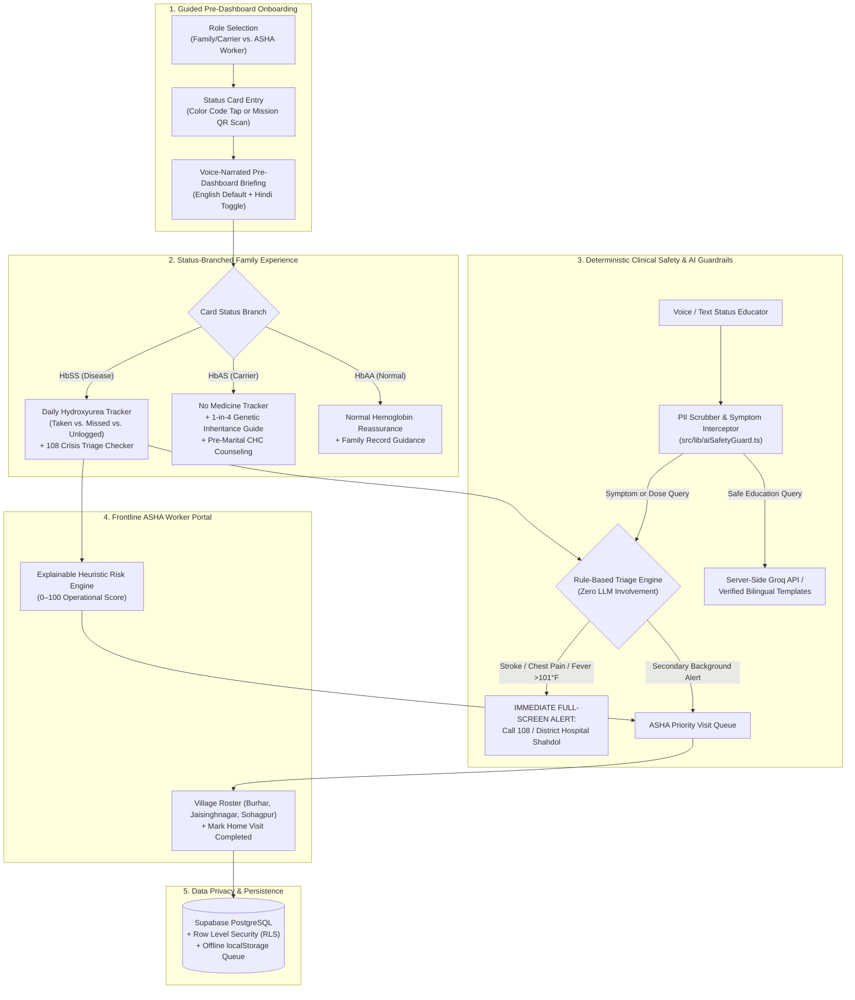
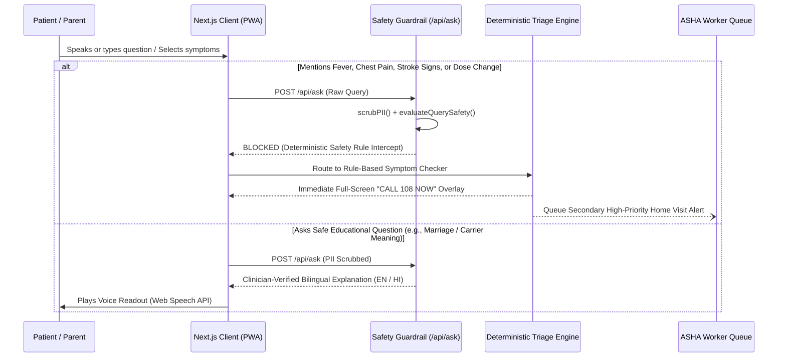

# Sickle Cell Care Loop (After the Card)

> **India screened 6+ crore people for sickle cell, but a status card is not care. We solve what happens the day after.**  
> *Built for UnivaBio 2026 — Theme: AI for Human Health (Detect Earlier • Understand Better • Live More Easily)*

🔗 **Live Prototype:** **[https://sickle-cell-care-loop.vercel.app/](https://sickle-cell-care-loop.vercel.app/)**


---

## 1. Problem Statement & Peer-Reviewed Evidence

India’s **National Sickle Cell Anaemia Elimination Mission** (launched in Shahdol, Madhya Pradesh) has screened **over 6.04 crore (60+ million) people**, diagnosing **2.16+ lakh patients (`HbSS`)** and identifying **16.7+ lakh carriers (`HbAS`)**. Yet issuing a physical or digital status card does not guarantee continuous care:

| Post-Screening Gap | Documented Clinical Evidence |
| :--- | :--- |
| **1. High Treatment Dropout** | In a tribal Gujarat cohort of 404 patients, **Hydroxyurea** raised coverage from 3.5% to 88% and reduced pain crises from **277 to 53.4 per 100 person-years**, yet **~25% were lost to follow-up** (*Dave et al., 2019*). In Bhopal, pediatric non-adherence was driven by improper follow-up (**64.5%**), drug unavailability (**67.7%**), and unawareness (**54.8%**) (*JCDR, 2022*). |
| **2. Status Card Misunderstanding** | In Koraput, Odisha, most respondents believed carriers actively transmit the disease and did not know that **carrier × carrier (`HbAS × HbAS`) marriage** carries a **25% (1 in 4) per-pregnancy risk** (*PMC7475140*). In the Indian SCD Registry, **85.2% of 324 tribal patients** did not know their status before enrolling (*ISCDR, 2024*). |
| **3. Missed Early Crisis Warnings** | Families miss early stroke signs, acute chest tightness, or high fever ($>101^\circ\text{F}$) at home until a life-threatening emergency escalates. |

---

## 2. System Architecture & Care Loop Diagram



---

## 3. Clinical Safety Gate & Triage Sequence

AI is strictly restricted to plain-language education. **Emergency triage and medication rules are 100% deterministic**:



---

## 4. Key Engineering & Clinical Highlights

1. **Guided 3-Step Onboarding (`src/components/OnboardingFlow.tsx`):**
   - Users identify their role and status card *before* entering the dashboard, receiving an audio-enabled briefing that explains what their card means and how their view is configured.
2. **Status-Branched Care Flows (`src/app/page.tsx`):**
   - **`HbSS` (Disease):** Includes the daily Hydroxyurea logger (`src/components/AdherenceTracker.tsx`), clinic follow-up dates, and crisis symptom checker (`src/components/SymptomChecker.tsx`). *Never advises starting, stopping, or altering a prescribed dose.*
   - **`HbAS` (Carrier):** Removes all medication trackers (`src/components/CarrierCounseling.tsx`), reassures carriers they are healthy, and explains the **1-in-4 (25%) per-pregnancy inheritance rule**.
   - **`HbAA` (Normal):** Reassurance and family record guidance.
3. **"No Log" $\neq$ "Missed Dose" (`src/lib/riskEngine.ts`):**
   - Explicitly separates **`TAKEN`**, **`MISSED`**, and **`UNLOGGED` (Silent)** days so families in low-connectivity areas who do not open the app are not falsely flagged at the same severity as explicit missed doses:
   $$\text{Risk Score} = \min\Big(100,\; 15 \cdot D_{\text{missed}} + 5 \cdot D_{\text{unlogged}} + \min(3 \cdot T_{\text{overdue}},\, 30) + 20 \cdot S_{\text{warning}}\Big)$$
4. **Zero-PII & Row Level Security (`supabase/schema.sql` & `src/lib/aiSafetyGuard.ts`):**
   - Regex sanitization strips Indian phone numbers and Mission Card IDs (`MP-SHD-xxx`) before any server-side LLM request. Supabase RLS policies isolate patient rows and village-assigned ASHA cohorts.

---

## 5. Project Structure

```text
├── docs/
│   └── SUBMISSION_PACKAGE.md      # 1-Page Executive Summary, Demo Script & Limitations
├── public/
│   └── manifest.json              # PWA manifest for mobile installation
├── scripts/
│   └── verify-rules.mjs           # Automated test suite for triage, risk score & PII rules
├── src/
│   ├── app/
│   │   ├── api/
│   │   │   ├── ask/route.ts       # Server-side guarded educator endpoint
│   │   │   ├── models/route.ts    # Live Groq model verifier (filters deprecated models)
│   │   │   └── transcribe/route.ts# Server-side Whisper-large-v3-turbo voice endpoint
│   │   ├── globals.css            # Clinical typography & warm canvas theme
│   │   ├── layout.tsx             # Root layout & PWA metadata
│   │   └── page.tsx               # Onboarding & status-branched dashboard router
│   ├── components/
│   │   ├── AdherenceTracker.tsx   # HbSS daily Hydroxyurea log (Taken/Missed/Unlogged)
│   │   ├── AshaDashboard.tsx      # Frontline worker cohort & explainable risk portal
│   │   ├── AskEducator.tsx        # Voice/Text Q&A with live safety interceptor
│   │   ├── CarrierCounseling.tsx  # HbAS 1-in-4 genetic counseling module
│   │   ├── EmergencyModal.tsx     # Non-blocking immediate Call 108 overlay
│   │   ├── MissionBanner.tsx      # NSCAEM Shahdol/Bhopal mission context
│   │   ├── MockQrScanner.tsx      # Interactive Mission Status Card QR simulator
│   │   ├── Navbar.tsx             # Bilingual (EN/HI) header & role switcher
│   │   ├── OnboardingFlow.tsx     # 3-step guided onboarding before dashboard entry
│   │   ├── StatusPicker.tsx       # Tactile color-coded card selector
│   │   ├── SymptomChecker.tsx     # Deterministic stroke/chest/fever rule checker
│   │   └── UnderstandCard.tsx     # Voice-narrated card explanation
│   ├── context/
│   │   └── AppContext.tsx         # Global state, audio synthesis & offline queue
│   └── lib/
│       ├── aiSafetyGuard.ts       # PII scrubber & symptom/dosage safety interceptor
│       ├── constants.ts           # Pre-verified bilingual templates & MP synthetic cohort
│       ├── riskEngine.ts          # Explainable heuristic dropout risk calculator
│       ├── speechService.ts       # Browser Web Speech API wrapper (en-IN / hi-IN)
│       ├── triageEngine.ts        # Fixed clinical emergency triage rules
│       └── types.ts               # Strict TypeScript domain interfaces
└── supabase/
    └── schema.sql                 # PostgreSQL tables & Row Level Security (RLS) policies
```

---

## 6. Local Setup & Verification

```bash
# 1. Install dependencies
npm install

# 2. (Optional) Configure environment variables
cp .env.example .env.local

# 3. Run automated clinical triage & safety verification suite (8/8 checks)
node scripts/verify-rules.mjs

# 4. Run development server on http://localhost:3000
npm run dev

# 5. Build for production
npm run build
npm start
```
